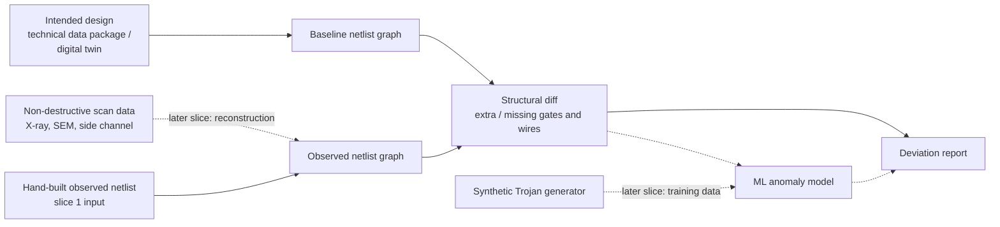

# Architecture: first vertical slice

The simplest complete version: represent the intended design and the observed chip as small gate-level netlists (gates and wires), compute their structural difference, and report extra or missing gates and connections. No ML yet; this is the comparison every later model builds on.

## Layers after slice 1

1. Load public benchmark circuits (for example Trust-Hub style netlists) and insert synthetic Trojans programmatically.
2. Graph features (fan-in, fan-out, rarely toggled nets) and a first classifier, scored on detection and false-positive rate.
3. Tolerance for reconstruction noise, since real scans produce imperfect netlists.
4. Side-channel and RF-activation signals as extra inputs.

## Design decisions

### 1. Compare against the design, not a golden chip

- **Constraint:** the topic requires detection without golden reference chips and names the technical data package or digital twin as the baseline.
- **Reasoning:** the design is always available to the program office; a verified clean chip often is not.
- **Rejected alternative:** compare each chip to a known-good physical chip. Simple, but that chip may not exist or may itself be compromised.
- **What breaks otherwise:** the method cannot be applied to most parts.

### 2. Structural diff before ML

- **Constraint:** Phase I asks for feasibility with theoretical detection rates on synthetic data, and later adversarial adaptability.
- **Reasoning:** an exact diff gives a ground-truth labeler for synthetic insertions and a baseline any ML model must beat.
- **Rejected alternative:** train a classifier directly on scan images. Possible later, but with no baseline it is hard to know whether it works.
- **What breaks otherwise:** no way to explain or validate detections.

### 3. Graphs as the shared representation

- **Constraint:** inputs differ (design files, scan reconstructions, simulations) and the detection target is a few gates.
- **Reasoning:** gates and wires as nodes and edges make small insertions visible as small graph changes, whatever the source.
- **Rejected alternative:** compare raw images pixel by pixel. Sensitive to imaging noise and blind to logic.
- **What breaks otherwise:** small Trojans get lost in noise.

### 4. Synthetic and public data only in this repository

- **Constraint:** training data is performer-sourced from synthetic and open benchmarks; this repository is public.
- **Reasoning:** public benchmarks and generated insertions are shareable; procured parts and any partner data stay elsewhere.
- **Rejected alternative:** none reasonable for a public repository.
- **What breaks otherwise:** a public repository holds data it should not.
